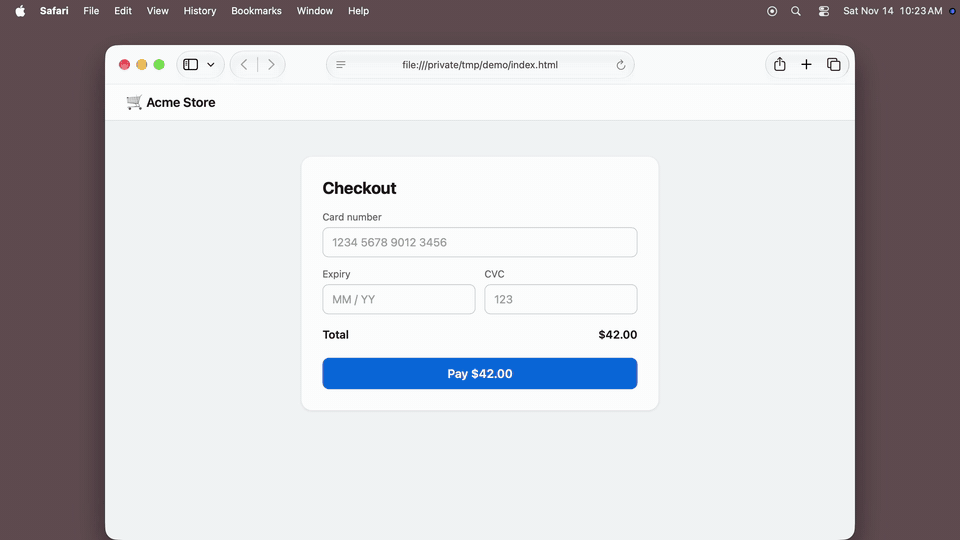
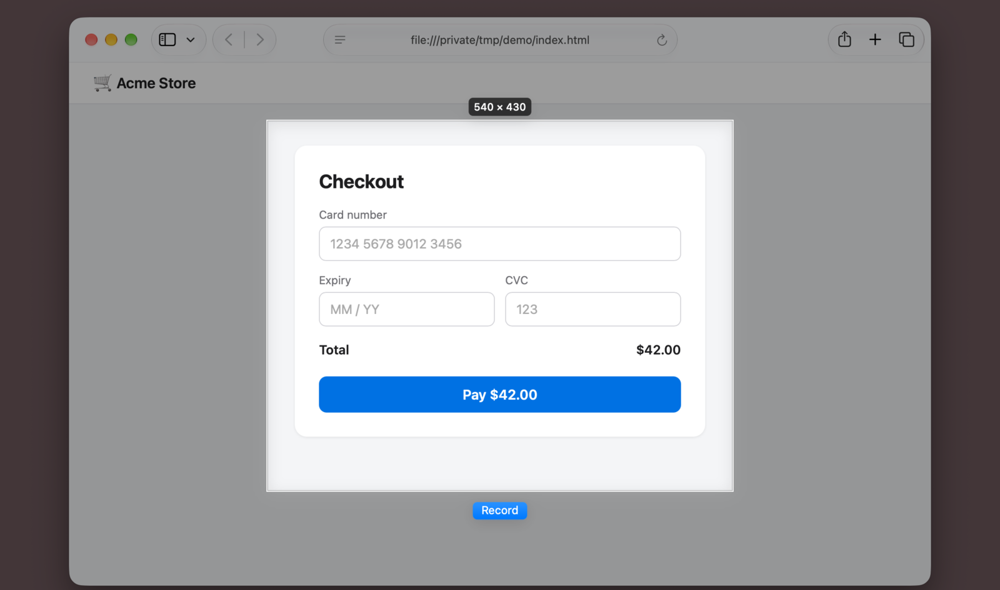
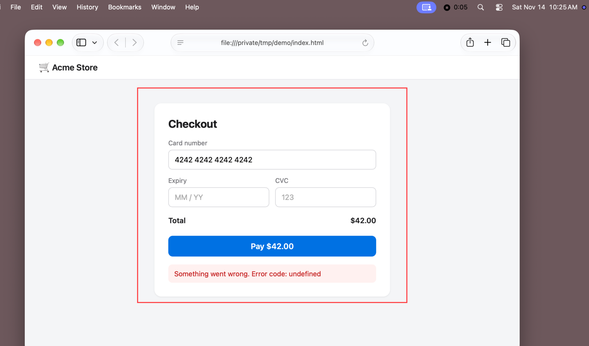
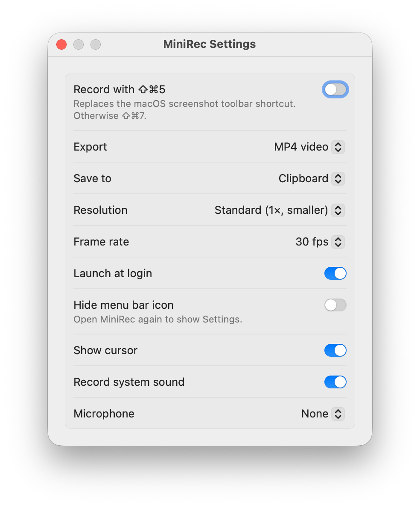
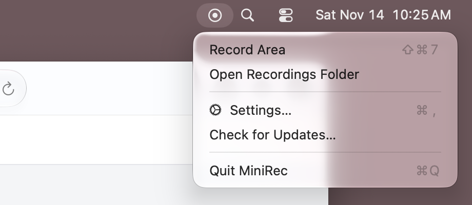
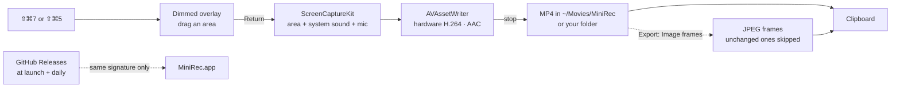

<p align="center">
  
</p>

<h1 align="center">MiniRec</h1>

<p align="center">
  <b>Show your agent the bug instead of describing it.</b><br>
  Press a shortcut, drag an area, record. The clip is on your clipboard, small enough to paste into any chat or agent.
</p>

<p align="center">
  <a href="https://github.com/madeyexz/minirec/releases/latest/download/MiniRec.zip"><b>⬇︎ Download for Mac</b></a>
  &nbsp;·&nbsp; macOS 15 or later &nbsp;·&nbsp; Apple Silicon &nbsp;·&nbsp; Free & open source
</p>

<p align="center">
  
</p>

<p align="center">
  <a href="docs/demo.mp4"><b>▶ Watch the 15-second demo</b></a>
</p>

---

## Why

Telling an agent "the error shows up after I click Pay" takes a paragraph and still misses things. A 10-second clip shows it. But most screen recorders are made for polished videos: they open an editor, export large files, and save to a library you must dig through.

MiniRec does one thing. **⇧⌘7, drag, Return, ⇧⌘7** — and the file is on your clipboard. A 15-second clip of a full screen is about 2 MB. If your agent cannot read video, MiniRec can export image frames instead.

## What you get

| | |
|---|---|
|  |  |
| **Drag any area.** The rest of the screen dims, and the size in pixels shows above the area. Press <kbd>Return</kbd> or click **Record**. | **A red frame shows what is recorded.** The frame and MiniRec's own windows are not in the video. The menu bar shows the time. |

- **Small files** — hardware H.264 at a bitrate that fits the area. A full-screen scroll at 1× is about 7 MB per minute; a still screen is a few KB.
- **Clipboard or folder** — paste the file into Claude, Cursor, Slack or Finder, or save it into a folder you choose.
- **Image frames for agents that cannot read video** — one JPEG every 0.5, 1 or 2 seconds. Frames that did not change are skipped, so you get only the moments that matter.
- **System sound and microphone** — record either, both, or neither. Both are mixed into one audio track.
- **Use ⇧⌘5 if you like** — one switch gives MiniRec the macOS screenshot shortcut; turn it off to give it back.
- **Stays out of the way** — no Dock icon, no editor, no library. Launch at login, and hide the menu bar icon if you want.
- **Updates itself** from GitHub Releases.

## Install

1. **Download** [`MiniRec.zip`](https://github.com/madeyexz/minirec/releases/latest/download/MiniRec.zip) and double-click it to unzip.
2. **Drag `MiniRec`** into your **Applications** folder. It must be there to update itself.
3. **Open it.** Apple notarized it, so macOS opens it after one confirmation.
4. **Record once.** Press <kbd>⇧</kbd> <kbd>⌘</kbd> <kbd>7</kbd>. macOS asks for **Screen & System Audio Recording** permission. Allow it, then open MiniRec again.

If you choose a microphone in Settings, macOS also asks for Microphone permission.

## How to use it

| Do this | To |
|---|---|
| <kbd>⇧</kbd> <kbd>⌘</kbd> <kbd>7</kbd> | Start: the screen dims so you can select an area |
| Drag | Select the area to record (on any display) |
| Toolbar under the area | See and change MP4 or frames, clipboard or folder, system sound, and microphone. MiniRec keeps your choice for the next recording |
| <kbd>Return</kbd> or **Record** | Start recording |
| <kbd>Esc</kbd> | Cancel the selection |
| <kbd>⇧</kbd> <kbd>⌘</kbd> <kbd>7</kbd> again, or click the red menu bar icon | Stop. The file goes to the clipboard (or your folder) and you hear a "pop" |
| <kbd>⌘</kbd> <kbd>V</kbd> | Paste the clip into your agent, chat, or Finder |

Recordings are saved in `~/Movies/MiniRec` unless you choose a folder.

### Settings

Click the menu bar icon → **Settings…** (or open MiniRec again while it runs).

<p align="center">
  
  &nbsp;
  
</p>

- **Record with ⇧⌘5** — turns off the macOS screenshot toolbar shortcut and uses ⇧⌘5 instead of ⇧⌘7. Turn it off and macOS gets ⇧⌘5 back.
- **Export** — **MP4 video**, or **Image frames** (JPEG, one every 0.5 / 1 / 2 s, unchanged frames skipped). With frames, all frame files go to the clipboard.
- **Save to** — **Clipboard** (saved in `~/Movies/MiniRec` and copied), or **Folder** (saved in the folder you choose; the clipboard does not change).
- **Resolution** — **Standard (1×)** for small files, or **Retina** for full detail.
- **Frame rate** — 15, 30 or 60 fps.
- **Launch at login** — also shows in System Settings → General → Login Items.
- **Hide menu bar icon** — the shortcut still records and stops. Open MiniRec again (Spotlight or Applications) to show Settings.
- **Show cursor**, **Record system sound**, **Microphone**.

## How it works



MiniRec is about 1,000 lines of Swift with no dependencies. It writes the video while it records, so there is no export step after you stop.

## Privacy

Everything stays on your Mac. No account, no analytics, no uploads. The only network request MiniRec makes is to ask GitHub for its latest release (at launch and once a day).

## FAQ

**Can Claude Code, Cursor or Codex read the MP4?** Most coding agents read images, not video. Set **Export → Image frames**, and MiniRec copies a few JPEG frames that any agent can read. Agents that read video (such as Amp or Gemini) can take the MP4.

**Why ⇧⌘7 and not ⇧⌘5?** macOS uses ⇧⌘5 for its own screenshot toolbar. Turn on **Record with ⇧⌘5** in Settings and MiniRec takes it over.

**macOS asks for Screen Recording permission again.** This happens when the app's signature changes, for example when you build it yourself without a signing certificate. Allow it once more.

**How do I update?** MiniRec updates itself when it is not recording. To check now, click the menu bar icon → **Check for Updates…**. It installs only a build that the same Apple developer team signed.

**How do I remove it?** Quit MiniRec from its menu, then move `/Applications/MiniRec.app` to the Trash. If you turned on **Record with ⇧⌘5**, turn it off first so macOS gets the shortcut back.

---

## For developers

```
Sources/MiniRec/main.swift              app delegate: menu bar item, flow (select → record → save), alerts
Sources/MiniRec/SelectionOverlay.swift  dimmed overlay on every display, drag to select
Sources/MiniRec/Recorder.swift          ScreenCaptureKit → AVAssetWriter, mixes system sound and mic
Sources/MiniRec/FrameExporter.swift     MP4 → JPEG frames, skips frames that did not change
Sources/MiniRec/Settings.swift          settings stored in UserDefaults, SwiftUI Settings window
Sources/MiniRec/Shortcut.swift          global hot key, macOS ⇧⌘5 on/off
Sources/MiniRec/Updater.swift           GitHub Releases updater with a signature check
scripts/build-app.sh                    builds, signs, and notarizes build/MiniRec.app and MiniRec.zip
.github/workflows/release.yml           builds and publishes a release when a vX.Y.Z tag is pushed
```

**Build** (needs Xcode Command Line Tools):

```sh
SIGN_IDENTITY="Apple Development: Your Name (ID)" ./scripts/build-app.sh
cp -R build/MiniRec.app /Applications/ && open /Applications/MiniRec.app
```

Without `SIGN_IDENTITY` the build is signed ad hoc: macOS asks for permission again after each build, and auto update is off.

**Release:**

```sh
git tag v0.5.0 && git push origin v0.5.0
```

GitHub Actions builds the app with the version from the tag, signs it with Developer ID and the hardened runtime, notarizes and staples it, and publishes `MiniRec.zip` as a release. The repository secrets `DEVELOPER_ID_P12_BASE64`, `DEVELOPER_ID_P12_PASSWORD`, `ASC_KEY_ID`, `ASC_ISSUER_ID`, and `ASC_KEY_P8` (an App Store Connect API key) give it the certificate and the notarization key. Without them, the release is signed ad hoc and installed copies do not update to it. Run the workflow by hand to build and notarize without a release.

The updater reads the latest release, takes the version from the `vX.Y.Z` tag, downloads the asset `MiniRec.zip`, and installs it only if an Apple certificate of the same team signed it (Apple Development or Developer ID).

## License

[MIT](LICENSE) © 2026 Ian Hsiao.
