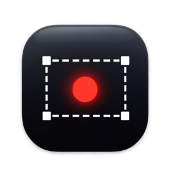

<p align="center">
  
</p>

<h1 align="center">MiniRec</h1>

<p align="center">
  <b>Give your agent video context.</b><br>
  A tiny, free Mac app: press a shortcut, drag an area, record. The clip goes straight to your clipboard. Paste it into your agent.
</p>

<p align="center">
  <a href="https://github.com/madeyexz/minirec/releases/latest/download/MiniRec.zip"><b>⬇︎ Download for Mac</b></a>
  &nbsp;·&nbsp; macOS 15 or later &nbsp;·&nbsp; Apple Silicon &nbsp;·&nbsp; Free & open source
</p>

<p align="center">
  
</p>

## Why

Your agent cannot see your screen. "It fails after I click Save" takes a paragraph to explain and still misses what happened. A 10-second clip shows it.

Normal screen recorders make videos for people: they open an editor, export big files, and keep a library. Your agent does not need any of that. MiniRec records and puts the file on your clipboard. Nothing to trim, name, or export.

## How to use it

| Press | What happens |
|---|---|
| <kbd>⇧</kbd> <kbd>⌘</kbd> <kbd>7</kbd> | The screen dims |
| Drag | Select the area. A toolbar under it shows your options |
| <kbd>Return</kbd> or **Record** | Recording starts. A red frame shows the area |
| <kbd>⇧</kbd> <kbd>⌘</kbd> <kbd>7</kbd> | Recording stops. The clip is on your clipboard |
| <kbd>⌘</kbd> <kbd>V</kbd> | Paste it into your agent |

<kbd>Esc</kbd> cancels. Prefer <kbd>⇧</kbd> <kbd>⌘</kbd> <kbd>5</kbd>? Turn on **Record with ⇧⌘5** in Settings.

The toolbar under the area sets **MP4 or image frames**, **clipboard or folder**, **system sound**, and **microphone**. MiniRec keeps your choice for the next time.

## What makes it good for agents

- **Clipboard first.** Stop, then paste. No save dialog, no editor.
- **Small files.** Hardware H.264, sized to the area. Even a 15-second full-screen clip is about 2 MB.
- **Image frames** for agents that read only images: a few JPEGs, and frames that did not change are skipped.
- **Tiny and quiet.** About 1,000 lines of Swift. No Dock icon, no account, no analytics. It launches at login if you want, and you can hide its menu bar icon.
- **Updates itself** from GitHub Releases. Apple notarized it.

## Install

1. **Download** [`MiniRec.zip`](https://github.com/madeyexz/minirec/releases/latest/download/MiniRec.zip), unzip it, and drag **MiniRec** into **Applications**.
2. **Open it**, then press <kbd>⇧</kbd> <kbd>⌘</kbd> <kbd>7</kbd>. Allow **Screen & System Audio Recording** when macOS asks, then open MiniRec again.

If you choose a microphone, macOS also asks for Microphone permission.

## Settings

Click the menu bar icon → **Settings…**, or open MiniRec again while it runs.

<p align="center">
  
</p>

**Resolution** is 1× by default for small files. Choose **Retina** for full detail. Recordings are kept in `~/Movies/MiniRec`, unless you choose a folder.

## FAQ

**Can my agent read an MP4?** Agents that read video can take the MP4 as it is. If yours reads only images, select **Frames** in the toolbar, and MiniRec copies JPEG frames instead.

**Does anything leave my Mac?** No. The only network request is the update check to GitHub, at launch and once a day.

**How do I remove it?** Quit MiniRec from its menu, then move it to the Trash. If you use ⇧⌘5, turn that setting off first, so macOS gets the shortcut back.

## For developers

```
Sources/MiniRec/main.swift              menu bar item, flow (select → record → save)
Sources/MiniRec/SelectionOverlay.swift  dimmed overlay, drag to select, options toolbar
Sources/MiniRec/Recorder.swift          ScreenCaptureKit → AVAssetWriter, system sound and mic
Sources/MiniRec/FrameExporter.swift     MP4 → JPEG frames, skips frames that did not change
Sources/MiniRec/Settings.swift          settings in UserDefaults, Settings window
Sources/MiniRec/Shortcut.swift          global hot key, macOS ⇧⌘5 on/off
Sources/MiniRec/Updater.swift           GitHub Releases updater with a signature check
scripts/build-app.sh                    builds, signs, and notarizes MiniRec.app and MiniRec.zip
.github/workflows/release.yml           publishes a release when a vX.Y.Z tag is pushed
```

**Build** (needs Xcode Command Line Tools):

```sh
SIGN_IDENTITY="Apple Development: Your Name (ID)" ./scripts/build-app.sh
cp -R build/MiniRec.app /Applications/ && open /Applications/MiniRec.app
```

Without `SIGN_IDENTITY`, the build is signed ad hoc: macOS asks for permission again after each build, and auto update is off.

**Release:** `git tag vX.Y.Z && git push origin vX.Y.Z`. GitHub Actions builds the app with that version, signs it with Developer ID, notarizes it, and publishes `MiniRec.zip`. It needs the repository secrets `DEVELOPER_ID_P12_BASE64`, `DEVELOPER_ID_P12_PASSWORD`, `ASC_KEY_ID`, `ASC_ISSUER_ID`, and `ASC_KEY_P8`. Installed copies update only to builds that the same Apple developer team signed.

## License

[MIT](LICENSE) © 2026 Ian Hsiao.
